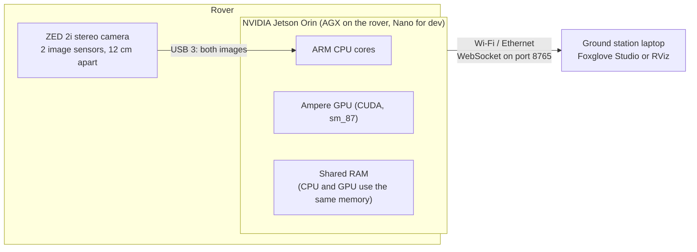
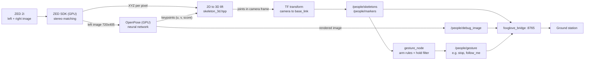
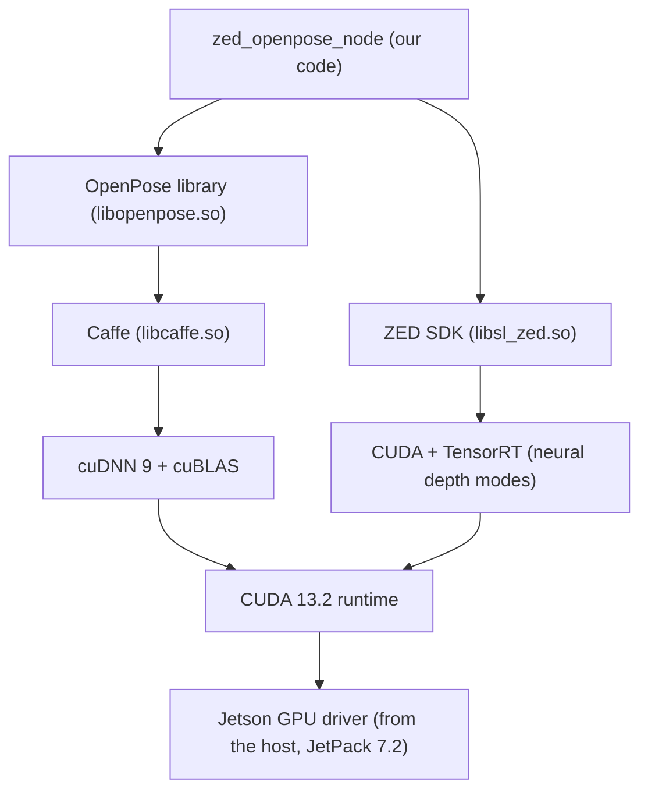
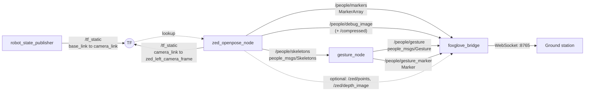

# ZED 2i + OpenPose on BILLEE: How the People/Pose Pipeline Works

This document explains, from first principles to the line of code, how the rover detects people
and their arm gestures. It is written for someone with an undergraduate EE background who has not
used ROS, neural networks or Docker before. Read it top to bottom once; afterwards the section
headings work as a reference.

**What you need to already know:** basic C++/Python reading, vectors and coordinate systems, and
what a USB device and an IP network are. Every other term is explained the first time it appears.
A glossary is at the end (§11).

**Where the code is** (all paths relative to the repository root):

| What | Path |
| --- | --- |
| Camera + pose node (C++) | `ros2_ws/src/perception/zed_openpose/src/zed_openpose_node.cpp` |
| 2D → 3D math (C++, header only) | `ros2_ws/src/perception/zed_openpose/include/zed_openpose/skeleton_3d.hpp` |
| Node parameters | `ros2_ws/src/perception/zed_openpose/config/zed_openpose.yaml` |
| Gesture rules + node (Python) | `ros2_ws/src/perception/people/people/gestures.py`, `gesture_node.py` |
| Message definitions | `ros2_ws/src/perception/people_msgs/msg/*.msg` |
| Launch file (starts everything) | `ros2_ws/src/perception/people/launch/people_rover.launch.py` |
| Jetson container image | `docker/Dockerfile.l4t-humble`, `docker/build_openpose.sh`, `docker/gpu_groups.sh` |
| VS Code dev container for the Jetson | `.devcontainer/l4t/devcontainer.json` |
| How to run it | `docs/RUN_GUIDE.md` §8 |

---

## 1. The system in one picture

### 1.1 Hardware



- The **ZED 2i** is a *stereo* camera: two image sensors side by side, like two eyes. Comparing the
  two images gives the distance to every pixel (§2.1).
- The **Jetson Orin** is a small computer built around a *system-on-chip*: CPU and GPU sit on one
  chip and share one block of RAM. The GPU does the heavy math (depth matching and the neural
  network).
- The **ground station** only displays results. Nothing heavy runs there.

### 1.2 Data flow



In words: the camera gives an image and a depth map; the neural network finds body joints in the
image as pixel coordinates; each joint's pixel is looked up in the depth map to get its 3D
position; that position is converted from "relative to the camera" to "relative to the rover";
a rule-based classifier turns arm positions into gestures; a bridge sends everything to the
ground station.

---

## 2. Background concepts

### 2.1 Stereo depth: how two images give distance

Hold a finger in front of your face and close each eye in turn: the finger jumps sideways more
than the far wall does. That sideways shift is called **disparity** (*d*, in pixels). Near objects
have large disparity, far objects small.

For two parallel cameras a distance *B* apart (the **baseline**), each with focal length *f*
expressed in pixels, similar triangles give:

$$Z = \frac{f \cdot B}{d}$$

where *Z* is the distance along the camera's viewing direction.

**Worked example.** ZED 2i: *B* = 0.12 m. At 1280×720 the focal length is roughly *f* ≈ 530 px
(the exact value comes from each camera's factory calibration). A person at *Z* = 3 m:

$$d = \frac{f B}{Z} = \frac{530 \times 0.12}{3} \approx 21 \text{ px}$$

Sensitivity: differentiating, $\Delta Z \approx \frac{Z^2}{fB}\Delta d$. A 1-pixel matching
error at 3 m is $\frac{9}{63.6} \approx 0.14$ m. The SDK matches to fractions of a pixel, so real
error is smaller, but the lesson holds: **depth error grows with the square of distance.**

The **ZED SDK** does the matching on the GPU for every pixel and gives, per pixel, a 3D point
(X, Y, Z). This array is called the **XYZ measure** or a **point cloud**. Some pixels have no
valid depth (stored as NaN, "not a number"): plain walls with no texture to match, areas only one
camera sees (occlusion), reflections, or things too close. The code must handle these holes (§4.4).

`depth_mode` selects the matching algorithm: `PERFORMANCE`/`QUALITY`/`ULTRA` are classical
matchers; `NEURAL*` use a small neural network (more complete depth, more GPU time). The default is
`ULTRA`, the mode the original Stereolabs sample uses.

### 2.2 Neural networks and OpenPose

A **neural network** here is a large function with millions of tuned numbers (*weights*) that maps
an image to an output. A **convolutional neural network (CNN)** applies the same small filters
(e.g. 3×3 pixels) across the whole image, layer after layer. Each filter is a multiply-accumulate
over a neighbourhood: the same operation as an FIR filter in signals, in 2D. Early layers respond
to edges, later layers to body parts. The weights were learned by CMU from thousands of labelled
photos; we only *run* the network (**inference**), we never train it.

**OpenPose** (CMU, 2017) is a CNN that finds human body *keypoints*. It outputs two things:

1. **Confidence maps**: one heat-map per body part ("how likely is a left elbow at this pixel").
   Peaks are candidate joints.
2. **Part Affinity Fields (PAFs)**: for each limb (e.g. elbow → wrist), a 2D vector field that
   points along the limb. OpenPose scores each candidate elbow-wrist pair by integrating the field
   along the line between them, then greedily assembles the best-scoring pairs into people. This
   is how it separates several people in one image without detecting each person first.

The result, per frame, is a 3D array `keypoints[person][part][3]` where the last axis is
`(u, v, score)`: `u` = pixel column, `v` = pixel row (down is positive), `score` = 0…1 confidence
(0 = not found).

**Pose models.** The keypoint list depends on the model file. We use **BODY_25** (25 points):

| Index | Part | Index | Part | Index | Part |
| --- | --- | --- | --- | --- | --- |
| 0 | nose | 9 | right hip | 18 | left ear |
| 1 | neck | 10 | right knee | 19 | left big toe |
| 2 | right shoulder | 11 | right ankle | 20 | left small toe |
| 3 | right elbow | 12 | left hip | 21 | left heel |
| 4 | right wrist | 13 | left knee | 22 | right big toe |
| 5 | left shoulder | 14 | left ankle | 23 | right small toe |
| 6 | left elbow | 15 | right eye | 24 | right heel |
| 7 | left wrist | 16 | left eye | | |
| 8 | mid hip | 17 | right ear | | |

"Right" is the **person's** right. A person facing the camera has their right side on the left of
the image. `COCO` (18 points) and `MPI` (15) are also supported; indices 0–7 are the same in all
three, which the gesture code relies on.

**Network input size** (`net_resolution`, default `320x240`): the image is scaled to this size
before inference. The cost of a CNN scales with the number of input pixels, so halving both
dimensions is about 4× faster but finds small (far) people less reliably.

### 2.3 GPU, CUDA, cuDNN, Caffe

- A **GPU** has thousands of simple arithmetic units. A CNN is billions of independent
  multiply-accumulates, which a GPU runs in parallel; a CPU would be 10–100× slower.
- **CUDA** is NVIDIA's platform for running general code on the GPU: a compiler (`nvcc`), a
  runtime library (`libcudart`) and the driver. Code is compiled for a GPU generation called the
  **compute capability**; Orin is **sm_87** (8.7).
- **cuDNN** is NVIDIA's library of fast neural-network building blocks (convolutions, pooling).
- **Caffe** is an older deep-learning framework. OpenPose uses it to load the model files
  (`.prototxt` = network layout, `.caffemodel` = weights) and run them through cuDNN.

Software stack inside the node process, top to bottom:



### 2.4 ROS 2 in five ideas

**ROS 2** (Robot Operating System) is not an operating system. It is a set of libraries and tools
that let separate programs on one or several computers exchange data. We use the **Humble**
release.

1. **Node**: one program (process) with one job, e.g. `zed_openpose_node`.
2. **Topic**: a named data channel, e.g. `/people/skeletons`. A node **publishes** messages to a
   topic, and any node **subscribes** to receive them. Publishers and subscribers don't know about
   each other; this is what lets the ground station "listen in" without changing rover code.
3. **Message**: a typed data structure defined in a `.msg` file (like a C struct), e.g.
   `people_msgs/Skeletons`. ROS generates C++ and Python classes from it.
4. **Parameter**: a named setting of a node, loaded from a YAML file at start-up, e.g.
   `net_resolution: 320x240`.
5. **Launch file**: a Python script that starts several nodes with their parameters in one
   command (`ros2 launch people people_rover.launch.py`).

Underneath, ROS 2 sends messages with **DDS**, a network protocol that finds peers automatically on
the local network. A **package** is ROS's unit of code (one folder with `package.xml`); **colcon**
is the tool that builds all packages in the workspace (`ros2_ws/`).

### 2.5 Coordinate frames and TF

A 3D point only means something relative to a **frame** (an origin plus three axes). ROS
convention: **x forward, y left, z up**, in metres.

Frames used here:

| Frame | Origin | Published by |
| --- | --- | --- |
| `base_link` | the rover's body reference point | (root of the tree) |
| `camera_link` | centre of the ZED 2i | `robot_state_publisher`, from the URDF |
| `zed_left_camera_frame` | the ZED's left lens | `zed_openpose_node` |

**TF** is ROS's system for publishing how frames relate. A transform from frame *A* to frame *B*
is a rotation *R* and translation *t*; a point known in *B* is expressed in *A* by

$$p_A = R \, p_B + t$$

TF chains these automatically (`base_link → camera_link → zed_left_camera_frame`), so any node can
ask "where is this point relative to the rover?" without knowing the chain.

The **URDF** (Unified Robot Description Format, `ros2_ws/src/robot_description/urdf/`) is an XML
description of the rover's parts and how they are mounted. It contains the camera mount
(`camera.urdf.xacro`):

```xml
<joint name="camera_joint" type="fixed">
    <parent link="base_link"/>
    <child link="camera_link"/>
    <origin xyz="0.3624 0.0 0.3424" rpy="0.0 0.0 0.0"/>
</joint>
```

i.e. the camera sits 36.24 cm forward and 34.24 cm above `base_link`, level and facing forward.
**If the camera is moved on the rover, this line must be updated**, or every skeleton will be
placed wrongly by the same offset.

### 2.6 Containers, the dev container and pixi

- A **Docker image** is a frozen filesystem with an OS and all installed software. A **container**
  is a running instance of an image. This guarantees the Jetson has exactly the right CUDA, ZED SDK
  and OpenPose versions regardless of what else is on it.
- The image is built in **layers** (one per Dockerfile step). Docker caches layers, so a rebuild
  after a late change only redoes the steps after it.
- The **NVIDIA container runtime** (`--runtime nvidia`) mounts the host's GPU driver and device
  files into the container. The container brings CUDA libraries; the driver must come from the
  host, which is why host and image must use the same **JetPack** release (7.2 = L4T r39.2).
- A **dev container** is VS Code opening a folder *inside* a container
  (`.devcontainer/l4t/devcontainer.json`), so the editor, terminals and builds all run in the
  Jetson image.
- **pixi** is a package manager (conda-based). ROS 2 Humble itself is installed by pixi from
  RoboStack into `ros2_ws/.pixi/envs/l4t`, not into the image. The image provides only what pixi
  can't: CUDA, ZED SDK, OpenPose.

---

## 3. Software architecture

### 3.1 Packages

| Package | Language | Role |
| --- | --- | --- |
| `zed_openpose` | C++ | Owns the camera; runs OpenPose; lifts to 3D; publishes skeletons, markers, images. Port of [stereolabs/zed-openpose](https://github.com/stereolabs/zed-openpose). Builds only on the Jetson image. |
| `people_msgs` | msg | Message types `Skeleton`, `Skeletons`, `Gesture`. |
| `people` | Python | `gesture_node`: skeletons → gesture → command. Also the rover launch file and Foxglove layout. |
| `robot_description` | URDF | Rover geometry, incl. the camera mount. |

On the ground station and on a Mac, `zed_openpose` detects that the ZED SDK and OpenPose are absent
and builds only its tests (see `CMakeLists.txt`). Everything else builds everywhere.

### 3.2 Nodes and topics



`people_rover.launch.py` starts all four nodes. With `standalone:=false` it skips
`robot_state_publisher` and `foxglove_bridge` because the drivetrain launch (`real.launch.py
foxglove:=true`) already runs them.

### 3.3 Messages

`Skeletons` (one per camera frame):

| Field | Meaning |
| --- | --- |
| `header.stamp` | when the ZED captured the image |
| `header.frame_id` | frame of all 3D joints: `base_link` |
| `model` | `BODY_25`, `COCO` or `MPI`: fixes the keypoint order |
| `image_width`, `image_height` | size of the image `u, v` refer to (720×405) |
| `people[]` | one `Skeleton` per detected person |

`Skeleton` (one person): parallel arrays `u[]`, `v[]`, `confidence[]` (2D, pixels), `joints[]`
(3D points in metres, NaN where unknown) and `centroid` (mean of the known 3D joints).

`Gesture`: `gesture` (`none`, `arms_u`, `t_pose`, `right_arm_up`, `left_arm_up`), `command` (what
the rover should do, from config), `confidence`, `position` (where the person is, in `base_link`).

---

## 4. Step by step: the life of one frame

### 4.1 Start-up: opening the camera

`ZedOpenPoseNode` constructor → `open_zed()` (`zed_openpose_node.cpp` lines 126–235):

1. Read all parameters (`declare_parameter`). Bad values (`alpha_pose` outside 0–1, etc.) throw
   immediately with a clear message.
2. Fill `sl::InitParameters`:
   - `camera_resolution = HD720` (1280×720 per sensor);
   - `depth_mode = ULTRA`;
   - `coordinate_units = METER`;
   - `coordinate_system = RIGHT_HANDED_Z_UP_X_FWD`: the ZED reports points with **ROS axes**
     (x forward, y left, z up). The original sample used Y-up (OpenGL convention); changing it here
     means no axis swapping is needed later.
   - `svo_path` set → replay a recorded `.svo2` file instead of the live camera (useful for testing
     at a desk).
3. `zed_.open(init)`. On failure the node throws `ZED open failed: CAMERA NOT DETECTED ...` and
   exits with code 1. That is the expected message on a Jetson without the camera.
4. Publish one **static transform** `camera_link → zed_left_camera_frame` with translation
   *y* = baseline / 2 (= +0.06 m: the left lens is 6 cm to the left of the camera's centre). The
   ZED reports XYZ relative to the left lens; this transform connects that to the URDF's
   `camera_link`.
5. Create the publishers and a TF listener, then start **two threads**.

### 4.2 Two threads: a two-stage pipeline

A **thread** is an independent flow of execution inside one program; two threads run at the same
time on different CPU cores. The node uses two, exactly like the Stereolabs sample:

- **ZED thread** (`run()`): grabs a frame and prepares OpenPose's input (CPU work).
- **OpenPose thread** (`findpose()`): runs the network on the GPU, then lifts and publishes.

While OpenPose processes frame *n*, the ZED thread already grabs and prepares frame *n+1*. This is
the same idea as pipelining in a CPU datapath: two stages overlap, so throughput is set by the
slower stage instead of the sum of both.

```
time ─────────────────────────────────────────────────────────►
ZED thread      [grab+prep 1][grab+prep 2]  wait  [grab+prep 3]  wait
OpenPose thread              [ OpenPose 1 + publish ][ OpenPose 2 + publish ]
```

**Hand-off between the threads** (lines 301–305 and 325–330). Shared state:

| Variable | Type | Meaning |
| --- | --- | --- |
| `pending_` | `shared_ptr<Frame>` | the newest prepared frame, or empty |
| `need_new_image_` | `atomic<bool>` | true = OpenPose has taken the last frame, grab another |
| `data_in_mtx_` | `mutex` | lock protecting `pending_` |

- ZED thread: waits until `need_new_image_` is true, grabs and prepares, then (under the lock)
  stores the frame in `pending_` and sets `need_new_image_ = false`.
- OpenPose thread: (under the lock) swaps `pending_` out; if it got a frame, sets
  `need_new_image_ = true` so the ZED thread starts the next grab, and processes the frame outside
  the lock.

A **mutex** ("mutual exclusion") ensures only one thread touches `pending_` at a time; without it
one thread could read a half-written pointer. An **atomic** variable is a flag both threads can
read and write safely without a lock.

Consequence: the camera is only grabbed as fast as OpenPose consumes, so frames never pile up and
latency stays at about one inference time. The output rate equals the OpenPose rate (§8).

### 4.3 ZED thread: grab and prepare (`run()`, lines 238–308)

Once, before the loop: `op::ScaleAndSizeExtractor` computes the scale factors between the 720×405
input image and the network input (`net_resolution`) and the debug output.

Per frame:

1. `zed_.grab(rt)`: capture both sensors and compute depth on the GPU. `rt.measure3D_reference_frame
   = CAMERA` means XYZ is relative to the camera (not to a world map).
2. **Timestamp**: the image's capture time from the ZED (live), or "now" (SVO replay, so TF
   lookups don't fall behind the recording).
3. `retrieveImage(LEFT, ..., 720×405)`: left image, scaled down by the SDK. 720×405 keeps the
   1280×720 aspect ratio (16:9) at a size OpenPose handles quickly.
4. `retrieveMeasure(XYZBGRA, ..., 720×405)`: the XYZ measure **at the same resolution**, so pixel
   (u, v) of the image and element (u, v) of the XYZ array refer to the same point. Deep-copied
   into the frame so the next grab can't overwrite it while OpenPose still uses it.
5. Convert BGRA (4 channels) to BGR (3 channels), the format OpenPose expects.
6. `cv_to_input.createArray(...)`: resize and normalise the image into the network's input tensor
   (a *tensor* is a multi-dimensional array of floats).
7. `cv_to_output.createArray(...)`: a copy at output size for drawing the debug image later.
8. Optional: publish `/zed/depth_image` and `/zed/points` (off by default; a full point cloud over
   Wi-Fi is several MB per frame).
9. Hand the frame over (§4.2).

### 4.4 OpenPose thread: inference (`findpose()`, lines 311–350)

Once, at thread start:

- `op::PoseExtractorCaffe extractor{BODY_25, model_folder, gpu 0}` and
  `extractor.initializationOnThread()` load the network (`pose/body_25/pose_deploy.prototxt` +
  `pose_iter_584000.caffemodel`, ~200 MB) onto the GPU. The models are not in the image or in git;
  `zed_openpose/scripts/get_openpose_models.sh` downloads them into `ros2_ws/models/openpose/` and
  checks their SHA-256 checksums.
- `op::PoseCpuRenderer`: draws skeletons onto the debug image.

The CUDA initialisation must happen on the thread that will use it (CUDA contexts are per thread),
which is why it is inside `findpose()` and not in the constructor.

Per frame:

1. `extractor.forwardPass(net_input, ...)`: run the CNN on the GPU, then OpenPose's PAF grouping.
2. `extractor.getPoseKeypoints()`: the `[people][25][3]` array of `(u, v, score)`, scaled back to
   720×405 pixel coordinates.
3. `publish_people(frame, keypoints)`: lift to 3D and publish (§4.5–4.7).
4. `renderer.renderPose(...)` and `publish_debug_image(...)`: draw the skeletons over the image and
   publish it raw and as JPEG.

Any exception in this thread (e.g. models missing) is logged as `FATAL` and shuts the node down,
rather than leaving a node that runs but never publishes.

### 4.5 From 2D keypoints to 3D joints (`skeleton_3d.hpp`)

This file is the sample's 3D logic, kept free of ZED/OpenPose types so it can be unit tested on any
machine. The node passes in a `lookup(i, j)` function that reads the XYZ array at column *i*, row
*j*.

For each person, `lift_person()`:

**Step 1: per keypoint.**
- If `score < render_threshold` (0.12): leave the joint unknown (NaN).
- Round `(u, v)` to the nearest pixel `(i, j)` and read XYZ there.
- If that pixel has no depth, call `patch_xyz()`: search squares of growing radius *r* = 0, 1, …, 9
  around the pixel, scanning each square row by row, and return the **first** valid XYZ found.
  Joints often land on depth holes (thin wrists, edges against background), and a neighbour a few
  pixels away is a good estimate. Beyond 9 pixels the joint stays unknown, because further pixels
  are likely to be background.

```
r=0      r=1        r=2
 X      . . .     . . . . .
        . X .     . . . . .
        . . .     . . X . .
                  . . . . .
                  . . . . .
```

**Step 2: centroid.** The mean of all known joints, the person's "centre of gravity".

**Step 3: limb filter.** For each limb in the model's limb list (`parts_link()`, e.g. 2–3 =
right shoulder → right elbow), keep it only if

- its length < **1.0 m** (`kMaxDistanceLimb`), and
- its midpoint is within **1.8 m** of the centroid (`kMaxDistanceCenter`).

Why: a joint whose depth came from the background (e.g. a hand in front of a wall 5 m away) gives
a "limb" several metres long. Real human limbs are shorter than 1 m. Rejected limbs are not drawn,
but the joints are still published so downstream code can decide. Unknown joints give NaN lengths,
and every comparison with NaN is false, so such limbs are dropped automatically.

### 4.6 From camera frame to rover frame (`publish_people()`, lines 352–426)

1. Ask TF for the transform `base_link ← zed_left_camera_frame` **at the frame's timestamp**
   (waiting up to 0.1 s).
2. Apply it to every joint and the centroid: $p_{base} = R\,p_{zed} + t$.
3. If TF is unavailable (e.g. `robot_state_publisher` not running), publish the 2D keypoints anyway
   but set all 3D values to NaN, and warn every 5 s: `No TF base_link <- zed_left_camera_frame`.

**Worked example.** OpenPose finds a right wrist; the ZED says it is at
$p_{zed} = (3.00, 0.20, 0.50)$ m (3 m ahead of the left lens, 20 cm left, 50 cm up). Both mounts
are level (*R* = identity), so only translations add:

| Step | Translation added | Point |
| --- | --- | --- |
| left lens → `camera_link` | (0, +0.06, 0) | (3.00, 0.26, 0.50) |
| `camera_link` → `base_link` | (0.3624, 0, 0.3424) | (3.36, 0.26, 0.84) |

So the wrist is 3.36 m ahead of the rover, 26 cm to its left, 84 cm above `base_link`.

### 4.7 Publishing

- **`/people/skeletons`**: one `Skeletons` message per frame, even when nobody is seen (empty
  `people`), so subscribers know the camera is alive.
- **`/people/markers`**: a `MarkerArray` for RViz/Foxglove 3D view. It starts with a `DELETEALL`
  marker (erases last frame's skeletons), then one red `LINE_LIST` per person: consecutive point
  pairs are drawn as line segments, one per accepted limb, 3 cm thick.
- **`/people/debug_image`** (raw BGR) and **`/compressed`** (JPEG, quality 80): OpenPose's own
  drawing. Use `/compressed` over Wi-Fi: raw is 720 × 405 × 3 ≈ 875 kB per frame, a JPEG of it is
  typically tens of kB.

### 4.8 Gesture recognition (`people/gestures.py`, `gesture_node.py`)

`gesture_node` subscribes to `/people/skeletons` and, for each message:

**1. Choose the person.** The person **closest to the rover**: distance from `base_link`'s origin
to their neck (else their centroid). If no 3D is available, the person with the widest shoulders in
the image (largest = probably closest).

**2. Classify using only 2D keypoints.** Depth is deliberately not used: a raised hand is small and
often has no depth. Everything is measured relative to the neck and divided by a **body scale** so
that the thresholds work at any distance:

- `scale` = shoulder width in pixels, or half the neck-to-mid-hip distance if larger (the shoulder
  width shrinks when the person turns sideways; torso length doesn't).
- For each arm, four numbers in units of `scale` (image *v* grows downward, so "up" = shoulder *v*
  minus joint *v*):
  - `elbow_up`, `wrist_up`: height of elbow/wrist above the shoulder;
  - `elbow_out`, `wrist_out`: horizontal distance from the neck, positive away from the body (the
    "outward" direction is taken from which side of the neck that shoulder is on, so it works facing
    toward or away from the camera).

If any of the 7 arm joints (neck, both shoulders, elbows, wrists) has confidence < 0.2, the result
is `none`.

**3. Rules** (checked in this order, first match wins):

| Gesture | Condition (both arms unless stated) | Default command |
| --- | --- | --- |
| `arms_u` | wrist_up > 0.8, elbow_up > −0.3, wrist_out > 0.2, \|wrist_out − elbow_out\| < 0.45 (forearm vertical) | `stop` |
| `t_pose` | \|wrist_up\| < 0.4, \|elbow_up\| < 0.4, wrist_out > 1.4 (arms level and straight out) | `come_here` |
| `right_arm_up` | right wrist_up > 1.0 and left wrist_up < 0 | `follow_me` |
| `left_arm_up` | left wrist_up > 1.0 and right wrist_up < 0 | `resume` |

**4. Hold filter.** OpenPose's output jitters frame to frame. `HoldFilter` only switches the
reported gesture (including back to `none`) after the same result is seen `hold_frames` (2)
times in a row. This is a debounce, like debouncing a mechanical switch. At ~6 frames/s, 2 frames ≈
0.3 s of delay.

**5. Publish** `/people/gesture` (every frame) and a yellow text label 0.6 m above the person's neck
on `/people/gesture_marker`.

The commands in `people/config/gestures.yaml` are placeholders: **no node acts on them yet.** The
planned next step is a node (e.g. in navigation) that subscribes to `/people/gesture` and acts on
`command`.

### 4.9 Viewing on the ground station

`foxglove_bridge` (port 8765) converts ROS topics into a WebSocket stream that **Foxglove Studio**
(a browser/desktop visualisation app) reads. The ground station doesn't need ROS for this; it only
needs network access to the rover.

1. Foxglove → *Open connection* → `ws://<rover-ip>:8765` (the dev Orin Nano is at `192.168.4.95`).
2. Import the layout `ros2_ws/src/perception/people/foxglove/people_rover.json`: an Image panel
   (debug image), a 3D panel (rover model, skeleton markers, gesture label) and a raw view of
   `/people/gesture`.

RViz (ROS's own viewer) also works from a ground station running ROS 2 on the same network: fixed
frame `base_link`, add `MarkerArray` `/people/markers` and `Image` `/people/debug_image`.

---

## 5. Building and deploying on the Jetson

### 5.1 What the image contains, layer by layer

`docker/Dockerfile.l4t-humble`, in build order:

| Step | Contents | Why |
| --- | --- | --- |
| Base | `ubuntu:24.04` | NVIDIA publishes no JetPack 7 base image; JetPack 7.2 is Ubuntu 24.04. |
| Basics | compilers, cmake, git, ... | build tools |
| User | `ros_user` (uid 1000), passwordless sudo | don't run as root |
| CUDA | from NVIDIA's Jetson apt repo, release `r39.2`: nvcc, cudart, cuBLAS, cuRAND, NPP, cuDNN 9, TensorRT 10 runtime | only the pieces needed (~7.5 GB instead of ~16.5 GB for the full JetPack) |
| ZED SDK | 5.5 for L4T 39.2, silent install | camera driver + depth |
| OpenPose | built from source by `docker/build_openpose.sh` into `/opt/openpose` | no prebuilt OpenPose for CUDA 13 / ARM exists |
| pixi | `/opt/pixi` | installs ROS 2 into the workspace |
| Fix-ups | ZED folder permissions, `gpu_groups.sh` | see §5.3 |

The image is ~9 GB. On the Orin Nano the OpenPose step alone took ~10.5 min (6 parallel jobs);
a rebuild where only late layers change takes seconds.

### 5.2 Patching OpenPose for CUDA 13

OpenPose was last updated in 2020 and its bundled Caffe is older still. `build_openpose.sh` pins
OpenPose commit `5c5d965` and applies these patches before building:

| Patch | Reason |
| --- | --- |
| `-std=c++11/14` → `-std=c++17` | CUDA 13's headers (Thrust/CUB) and current protobuf require C++17. |
| `prop.clockRate`, `prop.deviceOverlap`, `prop.kernelExecTimeoutEnabled` → constants | These `cudaDeviceProp` fields were removed in CUDA 13; Caffe only prints them. |
| `SetTotalBytesLimit(a, b)` → `SetTotalBytesLimit(a)` | Newer protobuf removed the two-argument form (used when reading the model file). |
| `CPATH=/usr/local/cuda/include/cccl` | CUDA 13 moved Thrust/CUB headers into `include/cccl`; Caffe includes `<thrust/...>`. |
| `CUDA_ARCH_BIN=87` | Compile GPU code only for Orin, which cuts build time and size. |

Model downloads in OpenPose's CMake are disabled (CMU's model server is offline); see §4.4.

### 5.3 The dev container and three non-obvious problems

`.devcontainer/l4t/devcontainer.json` runs the image with:

| Option | Purpose |
| --- | --- |
| `--runtime nvidia`, `--device nvidia.com/gpu=all` | GPU driver and device files from the host (CDI = Container Device Interface, the standard way to describe them) |
| `--privileged`, `--volume /dev:/dev` | USB access to the ZED, CAN bus devices |
| `--network=host` | the container shares the Jetson's network, so DDS and port 8765 work as if native |
| `--hostname=rover`, `--add-host=rover:127.0.1.1` | fixed hostname; resolvable inside the container |
| `PIXI_CACHE_DIR` in the workspace | pixi hard-links packages from its cache instead of copying (saves ~6 GB on the SD card) |
| `postStartCommand` | `sudo gpu_groups.sh`, then `pixi install --environment l4t` |

**Problem 1: user id remapping.** VS Code changes `ros_user`'s uid inside the container to match
your host user (e.g. 2002), so files you create in the mounted repo belong to you. It only re-owns
`$HOME`, so the ZED SDK folder (installed for uid 1000, mode 770) became unreadable and the build
silently skipped `zed_openpose`. Fix: the Dockerfile makes `/usr/local/zed` world-readable and its
`settings/` and `resources/` (calibration and AI models downloaded at run time) world-writable.

**Problem 2: GPU permissions in VS Code terminals.** Linux controls device access with file
permissions. The GPU device files (`/dev/nvmap`, `/dev/nvgpu/igpu0/*`, `/dev/dri/*`, ...) belong to
host groups (`video` = 44, `render` = 993, 982 on the dev Nano) whose numbers differ between
machines. CDI adds those groups only to the container's first process; VS Code opens every
terminal with `docker exec`, which takes groups from the container's `/etc/group`. Without them,
CUDA fails with `error 100` (no device) or `801`. Fix: `docker/gpu_groups.sh` runs at start,
reads the group id of each GPU device file and adds `ros_user` to it.

**Problem 3: two copies of GLib.** A program loads **shared libraries** (`.so` files) at start-up;
the dynamic linker loads each library name once and every user shares it. OpenPose links OpenCV's
GUI module, which pulls in the system's GLib 2.80; ROS from pixi brings GLib 2.88. Parts of each
got mixed, and the node aborted at start with
`libgio-2.0.so.0: undefined symbol g_variant_builder_...`. Fix (`zed_openpose/CMakeLists.txt`):
link pixi's GLib first and force it to stay loaded (`-Wl,--no-as-needed`), so the whole process
uses that one copy. Newer GLib is backward compatible, so the system libraries work with it.

### 5.4 Running it

Full commands are in `docs/RUN_GUIDE.md` §8. Short version, in the dev container on the Jetson:

```bash
cd ros2_ws
src/perception/zed_openpose/scripts/get_openpose_models.sh      # once, ~300 MB
pixi run -e l4t build --packages-select people_msgs zed_openpose people robot_description
source install/setup.bash
ros2 launch people people_rover.launch.py                        # ZED must be plugged in
```

Then connect Foxglove from the ground station (§4.9).

---

## 6. Parameters that matter

From `zed_openpose/config/zed_openpose.yaml` and `people/config/gestures.yaml`:

| Parameter | Default | Effect of changing it |
| --- | --- | --- |
| `net_resolution` | `320x240` | Larger: detects smaller/further people, slower (cost ∝ pixels). Multiples of 16. |
| `model_pose` | `BODY_25` | `COCO`: 18 points, needs its own model files. |
| `depth_mode` | `ULTRA` | `NEURAL_LIGHT`: fewer depth holes, more GPU load. |
| `camera_resolution` | `HD720` | `HD1080`/`HD2K` cost more USB bandwidth and depth compute; the OpenPose input stays 720×405. |
| `image_width/height` | 720×405 | Resolution of the OpenPose input and of the 3D lookup. |
| `render_threshold` | 0.12 | Keypoints below this score are neither drawn nor lifted to 3D. |
| `target_frame` | `base_link` | Frame of all published 3D data. |
| `publish_cloud`, `publish_depth` | false | Extra topics for debugging; heavy over Wi-Fi. |
| `svo_path` | "" | Replay a recording instead of the camera. |
| `conf_threshold` (gesture) | 0.2 | Arm joints below this → `none`. |
| `hold_frames` (gesture) | 2 | More: steadier, slower to react. |
| `commands.*` (gesture) | stop, come_here, follow_me, resume | The `command` string sent with each gesture. |

---

## 7. Verification done so far

On the dev Orin Nano (JetPack 7.2), 2026-11-02, in the dev container without the camera:

| Check | Result |
| --- | --- |
| Image build from the committed Dockerfile | passes |
| CUDA from a VS Code-style (`docker exec`) shell as `ros_user` | 1 device, no errors |
| Full workspace build (10 packages) | passes, `zed_openpose` included |
| `zed_openpose` unit tests (`test_skeleton_3d`: patch search, radius limit, thresholds, centroid, limb filter) | pass |
| `people` gesture tests (24 cases: every gesture, facing toward/away, BODY_25 and COCO, hold filter) | pass |
| `people_rover.launch.py` | `gesture_node`, `robot_state_publisher`, `foxglove_bridge` up; port 8765 open; TF `base_link → camera_link` = (0.362, 0, 0.342) |
| `zed_openpose_node` without a camera | exits with `CAMERA NOT DETECTED` (expected) |
| OpenPose BODY_25 on the GPU, standalone test on a sample photo | 5 people, 25 keypoints each |

**Not yet tested:** anything with the ZED 2i connected (live depth, 3D placement accuracy, gestures
on real people, end-to-end frame rate).

Run the tests yourself:

```bash
cd ros2_ws
pixi run -e l4t colcon test --packages-select zed_openpose people
pixi run -e l4t colcon test-result --verbose
```

---

## 8. Performance and limitations

**Measured** (Orin Nano, OpenPose alone, network input 368 px high, 640×480 photo): ~160 ms per
frame ≈ 6 frames/s. The node's default `320x240` input is smaller, so it should be somewhat faster,
and the AGX Orin on the rover has twice the GPU cores of the Nano at higher clocks. Both are
expectations until measured with the camera.

**First frame is slow:** 30–90 s after launch before the first skeleton. CUDA, cuDNN and cuBLAS
load their GPU code lazily from the SD card on first use. Later frames are not affected.

**Limitations to keep in mind:**

- **Depth range and holes.** Depth error grows with Z² (§2.1): at 10 m it is ~11× the error at 3 m.
  Joints over textureless or reflective surfaces may stay NaN.
- **Gesture assumptions.** The rules assume a roughly level camera and an upright person. Lying,
  sitting at extreme angles or a strongly tilted camera will misclassify.
- **One person decides.** Only the closest person's gesture is reported.
- **No tracking.** People have no identity across frames; `people[0]` in one frame may be a different
  person in the next.
- **TF must be running.** Without `robot_state_publisher`, 3D values are NaN (2D still works).
- **Wi-Fi bandwidth.** Subscribe to `/people/debug_image/compressed`, not the raw image, and leave
  `publish_cloud` off.

---

## 9. Troubleshooting

| Symptom | Cause | Fix |
| --- | --- | --- |
| `ZED open failed: CAMERA NOT DETECTED` | camera unplugged, USB 2 port, or no udev rule on the host | `lsusb \| grep 2b03` on the host; use a USB 3 port; install the udev rule (RUN_GUIDE §2.2) |
| `CUDA error 100` / `801`, `NvRmMemInitNvmap failed: Permission denied` | `ros_user` lacks the GPU device groups | `docker exec -u root <container> gpu_groups.sh`, or rebuild the dev container |
| `OpenPose: ... prototxt ... not found` (FATAL) | models not downloaded | run `get_openpose_models.sh` |
| `No TF base_link <- zed_left_camera_frame` | `robot_state_publisher` not running | use `people_rover.launch.py` (standalone) or start the drivetrain launch |
| `libgio-2.0.so.0: undefined symbol` | GLib mix-up (§5.3), usually after editing link order | restore the GLib lines in `zed_openpose/CMakeLists.txt` |
| colcon builds `zed_openpose` with "skipping the node" warning | ZED SDK or OpenPose not visible | only builds in the Jetson image; check `/usr/local/zed` is readable |
| Skeletons consistently offset from the real person | camera mount in URDF doesn't match the rover | update `camera_joint` in `camera.urdf.xacro` |
| Foxglove can't connect | wrong IP, or `foxglove_bridge` not running | `ss -ltn \| grep 8765` on the rover |

---

## 10. Where to go next

1. Test with the ZED connected; record an `.svo2` so later development can use `svo_path` at a desk.
2. Measure end-to-end frame rate on the AGX Orin; tune `net_resolution` and `depth_mode`.
3. Write the node that acts on `/people/gesture` `command` (navigation integration).
4. Add person tracking (stable IDs across frames) if following a specific person is needed.

---

## 11. Glossary

| Term | Meaning |
| --- | --- |
| Atomic variable | a variable that several threads can read/write safely without a lock |
| Baseline | distance between the two lenses of a stereo camera (12 cm on the ZED 2i) |
| CDI | Container Device Interface: standard description of host devices to expose to containers |
| CNN | convolutional neural network: stacks of learned 2D filters |
| colcon | the ROS 2 build tool |
| Confidence map | per-part heat-map output of OpenPose |
| Container / image | running instance / frozen filesystem of a Docker environment |
| CUDA | NVIDIA's platform for general-purpose GPU code |
| cuDNN | NVIDIA's library of neural-network operations |
| DDS | the network protocol ROS 2 uses to move messages |
| Disparity | horizontal pixel shift of a point between left and right images |
| Frame (coordinate) | origin + axes that a 3D point is expressed in |
| Inference | running a trained network on new input |
| JetPack / L4T | NVIDIA's OS + driver bundle for Jetson (JetPack 7.2 = Linux for Tegra r39.2) |
| Keypoint | one body joint found by OpenPose: (u, v, score) |
| Launch file | script that starts several ROS nodes with their parameters |
| Message | typed data structure sent over a topic |
| Mutex | lock that lets only one thread at a time into a section of code |
| NaN | "not a number": the floating-point value used here for "unknown" |
| Node | a ROS program |
| PAF | Part Affinity Field: OpenPose's limb-direction output used to group joints into people |
| pixi | package manager that installs ROS 2 into the workspace |
| Point cloud / XYZ measure | a 3D point for every pixel |
| sm_87 | CUDA compute capability of the Orin GPU |
| SVO | Stereolabs' recording format (replayable as if live) |
| Tensor | multi-dimensional array of numbers (network input/output) |
| TF | ROS's system for transforms between coordinate frames |
| Thread | independent flow of execution inside one program |
| Topic | named channel that nodes publish to and subscribe from |
| URDF | XML description of the robot's parts and mounts |
