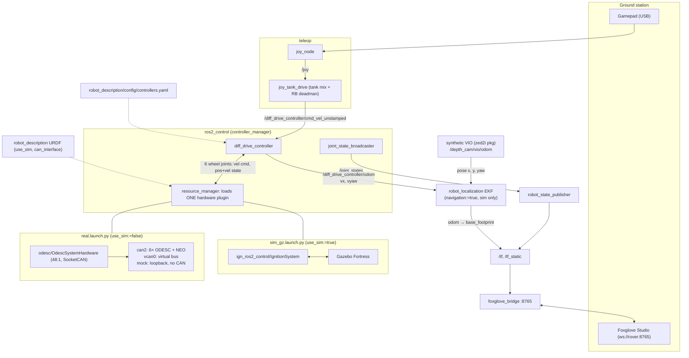

# Drivetrain architecture

There is one control stack with swappable hardware backends. `diff_drive_controller` only sees
wheel-joint position/velocity interfaces, so the controller, topics and TF are the same whether
the wheel data comes from Gazebo, the real ODESC controllers over CAN, or a loopback mock.

## Layers

| Layer | What | Where |
|---|---|---|
| CAN | `can2` at 500 kbit/s, ODrive CANSimple 0.5.x | `tooling/can-up` |
| Driver | `OdescSystemHardware`. This is the only place the 48:1 gear ratio is applied. | `src/odesc` |
| Control | `diff_drive_controller` (0.67 m track, 0.11 m wheel radius) + `joint_state_broadcaster` | `robot_description/config/controllers.yaml` |
| Model | URDF/xacro. `use_sim` picks the backend; per-joint CAN `node_id`s live here. | `robot_description/urdf/ros2_control.urdf.xacro` |
| Teleop | `joy_node` → `joy_tank_drive` | `src/teleop` |
| Viewers | Foxglove bridge `:8765`, RViz | `chassis_bringup/launch/viz.launch.py` |

## Backends

The launch file picks the backend; you never pass `use_sim` yourself. On the real path,
`can_interface:=` chooses what the driver talks to:

| `can_interface` | Socket | Other end | Use for |
|---|---|---|---|
| `can2` (default) | real SocketCAN | 6 ODESC V4.2 + NEO | driving the rover |
| `vcan0` | virtual CAN | `odesc_vcan_emulator.py`, or nothing (`candump`/`cansend` by hand) | checking the exact CAN frames |
| `mock` / `none` | none | the plugin loops commands back through the gear ratio | bringing up the full non-Gazebo stack with no hardware |

The CAN node ID ↔ wheel map has two copies, kept in sync by hand: `odesc/config/node_map.yaml`
(the canonical one) and the URDF `node_id` params.

## Odometry and TF

The TF tree is `odom → base_footprint → base_link → …`. `base_footprint` is the URDF root, on
the ground directly below `base_link` (the turning centre), and `robot_state_publisher` publishes everything below it. `diff_drive_controller`
publishes `/diff_drive_controller/odom` but no TF (`enable_odom_tf: false`). The
`odom → base_footprint` TF comes from the EKF in `navigation/launch/pose_estim.launch.py`,
which only runs in sim (`sim_gz.launch.py navigation:=true`, the default). The EKF
(`navigation/config/ekf_sim.yaml`, `two_d_mode: true`) fuses wheel odometry
(`/diff_drive_controller/odom`) as velocity only (`vx`, `vyaw`) and the synthetic VIO
(`/depth_cam/vio/odom`) as pose only (`x`, `y`, `yaw`), so position isn't counted twice.
The real path has no EKF yet, and so no `odom` frame.

Wheel odometry alone drifts quickly when the rover turns. The six wheels skid sideways, and
`diff_drive_controller` assumes they don't. In Gazebo it reports about 1.6× the real turn rate
(commanded 0.5 rad/s, actual 0.31 rad/s). The VIO pose corrects this in the EKF, so the viewers
show the EKF output (`/odometry/filtered`), not `/diff_drive_controller/odom`.

## Time

The sim uses `use_sim_time:=true` (Gazebo `/clock`) and the real stack uses wall clock.
`controllers.yaml` has `use_sim_time: true`, so `real.launch.py` writes a temporary copy with it
set to `false`. Without that, a standalone `ros2_control_node` waits forever for `/clock`.
Teleop always runs on wall clock.

## Cross-machine

Ground-station teleop reaches the rover's `diff_drive_controller` over plain DDS
(`rmw_fastrtps_cpp`, `ROS_DOMAIN_ID=42` from `pixi.toml`). That's fine on a LAN. A
bandwidth-limited radio link will need something like `zenoh-bridge-ros2dds` that forwards only
`cmd_vel` up and `odom`/`tf`/`joint_states` down. That isn't set up yet.
