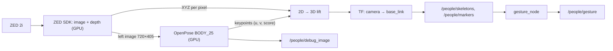

# People / pose: ZED 2i + OpenPose + point cloud

The rover finds people in the ZED 2i image with CMU OpenPose on the Jetson's GPU, places their
joints in 3D relative to `base_link`, and turns arm poses into gesture commands. The same node
publishes the ZED point cloud, and can also run as the point cloud alone (`openpose:=false`). This is
a ROS 2 port of [stereolabs/zed-openpose](https://github.com/stereolabs/zed-openpose). It runs only
in the Jetson `l4t` container, because only that image has the ZED SDK and OpenPose. Other machines
build just the tests.



## Run

Jetson container only. Setup (models, build, udev, calibration) is in
[running.md → First-time setup](running.md#first-time-setup).

**With the drivetrain** (the normal way), on the **Jetson**:

```bash
ros2 launch chassis_bringup rover.launch.py mode:=real camera:=cloud      # point cloud
ros2 launch chassis_bringup rover.launch.py mode:=real camera:=openpose   # point cloud + OpenPose
```

Add `can_interface:=mock` when no motors are connected. On the **ground station**:
`ros2 launch chassis_bringup ground_station.launch.py use_sim_time:=false view:=cloud` (or
`view:=openpose`), and the matching Foxglove layout below.

**Camera alone**, without any drivetrain launch, on the **Jetson**:

```bash
ros2 launch people people_rover.launch.py openpose:=false    # point cloud
ros2 launch people people_rover.launch.py                    # point cloud + OpenPose
```

This also starts `robot_state_publisher` and the Foxglove bridge (`standalone:=true`).
`rover.launch.py camera:=…` passes `standalone:=false`, because the drivetrain launch runs both.

| `people_rover.launch.py` arg | Default | |
|---|---|---|
| `openpose` | `true` | Run OpenPose and `gesture_node`. `false` = camera only: no model load, no `/people/*`, starts in seconds. |
| `point_cloud` | `true` | Publish `/zed/points` |
| `standalone` | `true` | Also start `robot_state_publisher` + `foxglove_bridge`. |
| `svo_path` | `""` | Replay a ZED `.svo2` recording instead of the live camera |
| `model_pose` | `BODY_25` | `COCO` needs its own model files |
| `target_frame` | `base_link` | frame of all 3D output |

**View it** on the ground station. Both layouts use fixed frame `base_link` and show the rover
model.

| Mode | Foxglove (Layouts → Import) | RViz (`ground_station.launch.py use_sim_time:=false …`) |
|---|---|---|
| point cloud | `ros2_ws/src/perception/people/foxglove/zed_points.json` | `view:=cloud` |
| point cloud + OpenPose | `ros2_ws/src/perception/people/foxglove/people_rover.json` | `view:=openpose` |

Measured on the dev Orin Nano (2026-11-13, HD720, depth `ULTRA`): the camera runs at 30 fps.
Point cloud alone: `/zed/points` at 8.5 Hz. With OpenPose: `/people/skeletons` and `/zed/points` at
5 Hz, the first skeleton about 10 s after launch, and the whole rover stack uses about 2.9 GB of RAM.
With `openpose:=true` the launch first drops the kernel's file cache (`sudo -n`): on the Orin the GPU
only gets RAM that is actually free, and OpenPose failed at startup when most RAM was cache.

## Code

| What | Path (under `ros2_ws/src/perception/`) |
|---|---|
| Camera + OpenPose node (C++) | `zed_openpose/src/zed_openpose_node.cpp` |
| 2D → 3D math (header-only, unit-tested) | `zed_openpose/include/zed_openpose/skeleton_3d.hpp` |
| Node params | `zed_openpose/config/zed_openpose.yaml` |
| Gesture rules + node (Python) | `people/people/gestures.py`, `gesture_node.py`, `people/config/gestures.yaml` |
| Messages | `people_msgs/msg/` (`Skeleton`, `Skeletons`, `Gesture`) |
| Launch | `people/launch/people_rover.launch.py` |

## Topics

| Topic | Type | |
|---|---|---|
| `/people/skeletons` | `people_msgs/Skeletons` | Published every frame, even with nobody in view. For each person: `u[]`, `v[]`, `confidence[]` (2D px), `joints[]` (3D m in `base_link`, NaN if unknown), `centroid`. |
| `/people/markers` | `MarkerArray` | One red line list per person |
| `/people/debug_image` (+ `/compressed`) | `Image` | OpenPose rendering. Use `/compressed` over Wi-Fi. |
| `/people/gesture` | `people_msgs/Gesture` | `gesture`, `command`, `confidence`, `position` |
| `/people/gesture_marker` | `Marker` | text label above the person |
| `/zed/points` | `PointCloud2` | XYZ + colour in `zed_left_camera_frame`. Every 4th pixel of the 720×405 depth map (~18k points, ~290 kB), at most `cloud_max_hz` (10). With OpenPose it runs at the OpenPose rate (~6 fps on the Nano). |
| `/zed/depth_image` | `Image` | off by default (`publish_depth`) |

## How it works

- **Two threads.** One grabs a ZED frame and prepares the input; the other runs OpenPose and
  publishes. A frame is grabbed only when OpenPose takes the previous one, so latency stays at
  about one inference.
- **2D → 3D.** Each keypoint with score ≥ `render_threshold` is looked up in the ZED XYZ map at
  the same pixel. If that pixel has no depth, the node searches outward up to 9 px. A limb is
  dropped if it's longer than 1.0 m or its midpoint is more than 1.8 m from the centroid, which
  catches joints that picked up background depth.
- **Frames.** The ZED reports in ROS axes (`RIGHT_HANDED_Z_UP_X_FWD`) relative to the left lens.
  The node publishes a static `camera_link → zed_left_camera_frame` transform (+0.06 m y) and
  transforms joints to `base_link` with TF at the image timestamp. If there's no TF, 2D is still
  published and 3D is NaN.
- **Gestures** (`gesture_node`). Only the person closest to the rover counts. Classification uses
  2D keypoints only, measured relative to the neck and scaled by body size. If any arm joint has
  confidence below 0.2, the result is `none`. A gesture must repeat `hold_frames` times in a row
  before it is reported. Rules, first match wins:

  | Gesture | Rule | Default command |
  |---|---|---|
  | `arms_u` | both wrists well above the shoulders, forearms vertical | `stop` |
  | `t_pose` | both arms level and straight out | `come_here` |
  | `right_arm_up` | right wrist above the head, left arm down | `follow_me` |
  | `left_arm_up` | left wrist above the head, right arm down | `resume` |

  **Nothing acts on `command` yet.** The commands are placeholders in `gestures.yaml`.

## Parameters

| Param | Default | Effect |
|---|---|---|
| `net_resolution` | `320x240` | Bigger finds smaller or more distant people, but is slower. Use multiples of 16. |
| `depth_mode` | `ULTRA` | `NEURAL_LIGHT` has fewer depth holes and costs more GPU |
| `camera_resolution` | `HD720` | Higher costs USB bandwidth. The OpenPose input stays 720×405. |
| `render_threshold` | `0.12` | Keypoints below this are neither drawn nor lifted |
| `cloud_step` | `4` | Keep every Nth pixel in `/zed/points`. Lower is denser and heavier. |
| `cloud_max_hz` | `10.0` | Rate cap on `/zed/points`. `0` = every camera frame. |
| `conf_threshold` (gesture) | `0.2` | Arm joints below this give `none` |
| `hold_frames` (gesture) | `2` | Higher is steadier but slower to react |

## The Jetson image

`docker/Dockerfile.l4t-humble` starts from NVIDIA's Isaac ROS Humble image (L4T 36.4: CUDA 12.6,
cuDNN 9, TensorRT 10.3, OpenCV 4.5.4). It adds the ZED SDK 5.4 and OpenPose, which
`docker/build_openpose.sh` builds from source into `/opt/openpose` with 3 parallel jobs
(`OPENPOSE_JOBS` in `.devcontainer/l4t/devcontainer.json`; 21 min on the Orin Nano).

OpenPose (pinned at `5c5d965`) needs these patches for current CUDA and protobuf:

| Patch | Why |
|---|---|
| `-std=c++11/14` → `c++17` | CUDA 12+ Thrust needs ≥ C++14 |
| `cudaDeviceProp` `clockRate`/`deviceOverlap`/`kernelExecTimeoutEnabled` → constants | Deprecated in CUDA 12, removed in CUDA 13 |
| `SetTotalBytesLimit(a, b)` → `(a)` | Newer protobuf removed the 2-arg form |
| `CPATH=/usr/local/cuda/include/cccl` | CUDA 13 only |
| `CUDA_ARCH_BIN=87` | Orin only. Cuts build time. |
| cuDNN algorithms: zero workspace only (`cudnn_conv_layer.cpp`, applied after `cmake`) | Caffe's cuDNN 8+ code accepted any workspace that fit in *all* free GPU memory, and each of BODY_25's 114 conv layers allocated its own (×3 streams, plus backward-pass space inference never uses). That took ~1.9 GB and OpenPose died on its first frame (`out of memory`). Zero-workspace algorithms ran at the same speed. |

OpenPose's CMake model download is disabled because CMU's model server is offline. Models come
from `get_openpose_models.sh` instead.

Traps in the Isaac ROS base:

| Trap | Symptom | Fix |
|---|---|---|
| `dl.yarnpkg.com` apt source with a dead key | every `apt-get update` exits 100 | Dockerfile deletes `yarn.list` |
| Jetson repo offers `libopencv-dev` 4.8 over the base's 4.5.4 | CMake fails on `libopencv_core.so.4.8.0` | don't install `libopencv-dev`; use the base's 4.5.4 |
| cuDNN runtime only | `cuDNN not found` | dev + header packages pinned to the runtime version |
| protobuf 26 in `/usr/local`; Boost 1.80 over `/usr` | Caffe picks the wrong protobuf; `undefined reference to boost::filesystem::path::append_v3` | `build_openpose.sh`: `/usr` first on `CMAKE_PREFIX_PATH` and `CPATH`, `Boost_DIR` → 1.80 |

Dev container problems, already fixed:

- **UID remap.** VS Code remaps `ros_user`'s uid to your host uid, so `/usr/local/zed` (owned by
  uid 1000) became unreadable and the build silently skipped `zed_openpose`. The Dockerfile now
  makes it world-readable, and makes `settings/` and `resources/` writable.
- **GPU groups.** `docker exec` terminals only get groups listed in the container's `/etc/group`,
  and the host GPU device groups (video, render, ...) aren't there, so CUDA failed with error 100
  or 801. `docker/gpu_groups.sh` runs on container start and adds `ros_user` to each GPU device's
  group.
- **ZED udev rule.** Without Stereolabs' rule on the host, the ZED's sensor (HID) device is
  root-only and the camera fails to open (`[ZED][MCU] Permissions denied`). `docker/zed_udev.sh`
  runs on container start and installs the image's `99-slabs.rules` on the host, through the
  host's `/etc/udev/rules.d` and `/run/udev` mounted by `.devcontainer/l4t/devcontainer.json`.
- **ZED calibration.** The SDK downloads `SN<serial>.conf` on a camera's first open (needs
  internet), into the container, so a rebuild loses it. The container start copies
  `configs/zed/SN*.conf` into `/usr/local/zed/settings/`.
- **Two GLibs.** OpenPose pulls in the system GLib 2.72 and pixi brings 2.88. Mixing them gave
  `libgio-2.0.so.0: undefined symbol g_variant_builder_...`. `zed_openpose/CMakeLists.txt` links
  pixi's GLib first with `-Wl,--no-as-needed`.

## Status

Tested on the dev Orin Nano with the team's ZED 2i (2026-11-13), L4T 36.4 image: the camera
opens, the point cloud runs alone and together with OpenPose, through both `people_rover.launch.py`
and `rover.launch.py camera:=…`, and the ground station receives both. Not tested yet: 3D accuracy
of the skeletons, gestures on real people, and anything with the drivetrain's motors. The unit
tests (`test_skeleton_3d`, 24 gesture cases) pass.

```bash
pixi run -e l4t colcon test --packages-select zed_openpose
pixi run -e l4t colcon test-result --verbose
# people: colcon's pytest run currently crashes at startup (pytest 9 vs the launch_testing
# plugin). Run its tests directly with plugin autoload off:
cd src/perception/people && PYTEST_DISABLE_PLUGIN_AUTOLOAD=1 python -m pytest -q test
```

Limitations: depth error grows with distance squared. Joints over textureless surfaces may stay
NaN. The gesture rules assume an upright person and a level camera. There's no person tracking
across frames.

Next steps: record an `.svo2` with the camera so you can develop with `svo_path` away from the
rover; check the skeletons' 3D positions against measured distances; write the node that acts
on `/people/gesture`.

## Troubleshooting

| Symptom | Fix |
|---|---|
| `ZED open failed: CAMERA NOT DETECTED` | No camera (this is expected without one), or a USB 2 port. Check `lsusb \| grep 2b03` on the host. |
| `[ZED][MCU] Permissions denied`, then `NOT VALID SERIAL NUMBER FOR SENSORS MODULE MCU` | No ZED udev rule on the host. On the host, `ls /etc/udev/rules.d/99-slabs.rules`; if it's missing, **Rebuild Container** (the container start installs it). |
| `out of memory` (`syncedmem.cpp`), `CUDNN_STATUS_INTERNAL_ERROR`, `NvMapMemAlloc… error 12` | Not enough RAM, which the GPU shares. On the host, `free -m` must show at least 3000 MB `available` before launching. An image built before 2026-11-13 also needs **Rebuild Container** (zero-workspace patch above). |
| `CUDA error 100` / `801`, `NvRmMemInitNvmap failed` | GPU groups missing: `docker exec -u root <container> gpu_groups.sh`, or rebuild the container |
| `OpenPose: ... prototxt ... not found` | Run `get_openpose_models.sh` |
| `No TF base_link <- zed_left_camera_frame` | `robot_state_publisher` isn't running. Use `standalone:=true` or start the drivetrain. |
| `libgio-2.0.so.0: undefined symbol` | The GLib link lines in `zed_openpose/CMakeLists.txt` were changed. Restore them. |
| `zed_openpose` "skipping the node" at build | ZED SDK or OpenPose not visible. This is normal off the Jetson image. On the Jetson, check that `/usr/local/zed` is readable. |
| Skeletons offset from the real person | `camera_joint` in `robot_description/urdf/camera.urdf.xacro` doesn't match the real mount |
